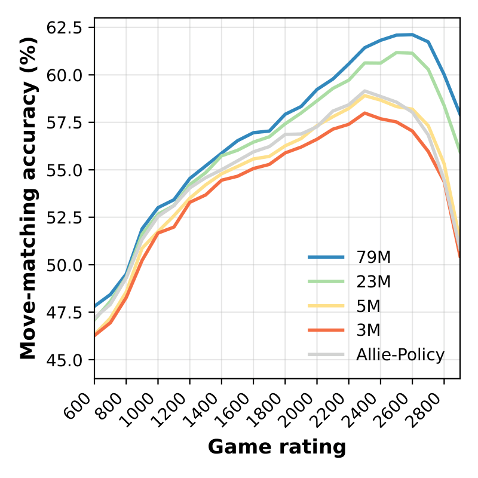

# Maia-3: human-like chess play and analysis engine

## [models](https://huggingface.co/collections/MaiaChess/maia3)/[code](https://github.com/CSSLab/maia-chess)/[paper](https://arxiv.org/abs/2605.19091)/[website](https://maiachess.com)

[](https://huggingface.co/collections/MaiaChess/maia3)
[](https://arxiv.org/abs/2605.19091)


Maia-3 is a family of chess transformer models for predicting human moves across
skill levels. This repository contains the inference code needed to run the
released Maia-3 weights as a UCI chess engine.



Maia3 is built on Chessformer, our novel transformer architecture for chess modeling. Read the paper here: [Chessformer: A Unified Architecture for Chess Modeling](https://arxiv.org/abs/2605.19091)

If you use Maia-3 in your work, please cite our paper:
```bibtex
@inproceedings{monroe2026chessformer,
title={Chessformer: A Unified Architecture for Chess Modeling},
author={Daniel Monroe and George Eilender and Philip Chalmers and Zhenwei Tang and Ashton Anderson},
booktitle={The Fourteenth International Conference on Learning Representations},
year={2026},
url={https://openreview.net/forum?id=2ltBRzEHyd}
}
```

## Install

```bash
git clone https://github.com/CSSLab/maia3.git
cd maia3
python -m pip install .
```

For development, install in editable mode:

```bash
python -m pip install -e .
```

You can also run directly from the repo without installing:

```bash
python -m maia3.uci --help
```

## Quick Start

Run the 5M Maia3 model as a UCI engine:

```bash
maia3-5m
```

The first run downloads the checkpoint from Hugging Face and caches it locally.
After that, the same command reuses the cached file.

You can pre-download the default 5M model before opening a chess GUI:

```bash
maia3-cache
```

You can also pass the Hugging Face model URL directly:

```bash
maia3-uci --model https://huggingface.co/UofTCSSLab/Maia3-79M
```

List built-in aliases:

```bash
maia3-uci --list-models
```

## Models

The built-in aliases and preset commands apply the correct architecture settings
automatically.

| Model | Best for | Hugging Face repo | Command |
| --- | --- | --- | --- |
| 5M | First try, CPU, chess GUIs | `UofTCSSLab/Maia3-5M` | `maia3-5m` |
| 23M | Better accuracy | `UofTCSSLab/Maia3-23M` | `maia3-23m` |
| 79M | Best accuracy | `UofTCSSLab/Maia3-79M` | `maia3-79m` |
| 3M ablation | Paper ablation | `UofTCSSLab/Maia3-ablate-3M` | `maia3-3m-ablation` |

Short aliases also work:

```bash
maia3-uci --model 3m
maia3-uci --model 5m
maia3-uci --model 23m
maia3-uci --model 79m
```

`maia3-3m` is kept as a compatibility alias for `maia3-3m-ablation`.

Cache a larger model before opening a GUI:

```bash
maia3-cache --model maia3-79m
```

If a Hugging Face repository contains more than one checkpoint file, choose one:

```bash
maia3-uci --model UofTCSSLab/Maia3-79M --checkpoint-filename maia3-79m.pt
```

To use a local checkpoint while still applying a built-in config:

```bash
maia3-uci --model maia3-79m --checkpoint-path /path/to/maia3-79m.pt
```

Pass local files with `--checkpoint-path`, not `--model`, so Maia3 knows
whether to use a built-in architecture preset or your custom architecture flags.

To use a fully custom checkpoint, pass the checkpoint and the matching
architecture flags:

```bash
maia3-uci --checkpoint-path /path/to/custom.pt \
  --history 8 --use-padding \
  --dim-vit 256 --head-hid-dim 256 --num-heads 8 \
  --gab-per-square-dim 0 --gab-gen-size 64 --gab-intermediate-dim 64
```

## UCI Options

The engine reads UCI commands from stdin and writes responses to stdout. Any
UCI-aware chess GUI or wrapper can drive it.

For manual testing, use the standard UCI position forms:
`position startpos moves e2e4` or `position fen <six-field FEN>`.

User-facing options:

- `Elo`: set both player and opponent Elo.
- `SelfElo`: set the side-to-move Elo.
- `OppoElo`: set the opponent Elo.
- `Temperature`: move sampling temperature. `0` means argmax.
- `TopP`: nucleus sampling threshold. `1.0` disables top-p filtering.
- `MultiPV`: number of likely human moves to show as UCI info lines.

## Use With Nibbler or Another Chess GUI

Maia3 can be added to any GUI that supports UCI engines, including Nibbler.

Recommended first setup:

```bash
python -m pip install .
maia3-cache --model maia3-5m
```

Then add a new UCI engine in your GUI:

| Setting | Value |
| --- | --- |
| Engine executable | `maia3-5m` |
| Arguments | none |

If you use one of the preset executables (`maia3-5m`, `maia3-23m`, or
`maia3-79m`), leave the arguments field empty. Do not add `--model` or point
Nibbler at a `.pt` checkpoint file.

If you see an error about local checkpoint files needing `--checkpoint-path`,
the GUI is passing an executable or checkpoint path as an argument. Clear the
arguments field and keep only the preset executable selected.

If your GUI asks for a full path to the executable, find it with:

```bash
which maia3-5m
```

On Windows:

```powershell
where maia3-5m
```

You can use the larger models the same way by selecting `maia3-23m` or
`maia3-79m` as the engine executable. Pre-caching is recommended because some
GUIs time out if an engine downloads a checkpoint during startup.

Maia3 starts the UCI handshake before loading the model, then loads the
checkpoint on `isready` or `go`. During analysis it emits standard `MultiPV`
`info` lines with WDL values from Maia3's value head, then returns `bestmove`.
Those WDL values are human-game outcome predictions for the candidate line, not
Stockfish-style search evaluations. The centipawn field is a GUI compatibility
score derived from the WDL head, not a searched engine evaluation.

Launch with reconstructed move history:

```bash
maia3-uci --model maia3-79m --use-uci-history
```

Launch on CPU:

```bash
maia3-uci --model maia3-5m --device cpu --no-use-amp
```

By default, Maia3 only loads tensor state-dict checkpoints. If you need to load
an old pickled checkpoint from a source you trust, add `--trust-checkpoint`.

## Example via python-chess

```python
import chess
import chess.engine

eng = chess.engine.SimpleEngine.popen_uci([
    "maia3-uci",
    "--model", "maia3-5m",
    "--use-uci-history",
    "--elo", "1500",
])

board = chess.Board()
print(eng.play(board, limit=chess.engine.Limit(nodes=1)).move)
eng.close()
```

If the `maia3-uci` script is not on your `PATH`, use Python module execution:

```python
import sys

cmd = [sys.executable, "-m", "maia3.uci", "--model", "maia3-5m"]
```

## Scoring Moves

Maia3 can also report how likely it thinks a move is: the log-probability of a
given move in a given position, for players of given Elos. This is useful for
measuring how human-like moves are or for comparing players to the model.

Score every move played in a PGN, writing one JSON line per move:

```bash
maia3-score --model maia3-5m --pgn games.pgn -o scores.jsonl
```

Each row has `game`, `ply`, `fen` (the position before the move), `move`,
`played`, `self_elo`, `oppo_elo` and `logp`. Options:

- `--moves all` scores every legal move at each ply, not only the played one.
- `--format csv` writes CSV instead of JSON lines.
- `--white-elo` / `--black-elo` override the PGN's `WhiteElo` / `BlackElo`
  headers. Games without them fall back to `--elo` (default 1500), with a warning.
- `--pgn` may be repeated; without it, PGN is read from stdin.

Model options (`--model`, `--checkpoint-path`, `--device` and so on) are the
same as `maia3-uci`'s.

Two defaults differ from `maia3-uci`, so scores may not match what a GUI shows
for the same position:

- **History.** Scoring feeds the model the game's previous positions, as
  `maia3-uci --use-uci-history` does. `maia3-uci` (and the preset executables)
  repeat the current position instead; pass `--no-use-history` to match it.
- **Precision.** Scoring runs in full fp32. On CUDA, `maia3-uci` uses mixed
  precision by default, which is faster but changes log-probabilities slightly
  (around the second or third decimal place). Pass `--use-amp` to match it, or
  for faster bulk scoring. Neither setting matters on CPU, which is always fp32.

From Python:

```python
import chess
from maia3.scoring import Maia3Scorer

scorer = Maia3Scorer.from_pretrained("maia3-5m", device="cpu")

board = chess.Board()
board.push_san("e4")  # push moves rather than using a FEN, so history is kept
moves = [board.parse_san("e5"), board.parse_san("c5")]

[logps] = scorer.log_probabilities(
    [scorer.featurize_position(board, moves, self_elo=1500, oppo_elo=1500)]
)
```

`Maia3Scorer(..., use_history=False, use_amp=True)` switches the same two
settings. For whole games, `scorer.featurize_game(game, white_elo, black_elo)`
featurizes every ply and is faster than scoring positions one by one.
`log_probabilities` batches its inputs, so pass it many at once.

## Legacy Entry Point

The old command still works from the repository root:

```bash
python code/uci.py --model maia3-5m
```

New integrations should prefer `maia3-uci` or `python -m maia3.uci`.
